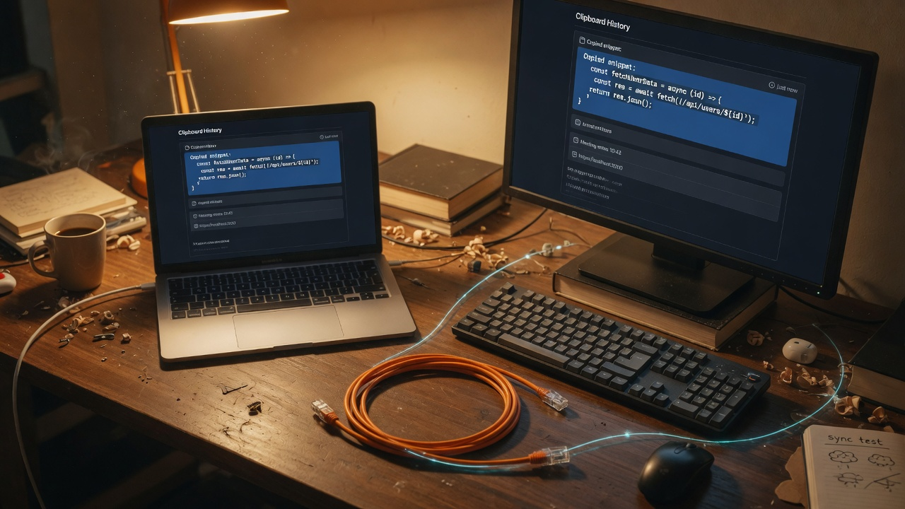

# ClipSync

> **Experimental.** Plain-text sync is working in a macOS ↔ Arch Linux setup, with authenticated LAN connections and automatic reconnection after service restarts verified. Broader desktop compatibility, sleep/wake, and login/logout recovery are still being validated.

<p align="center">
  
</p>

ClipSync synchronizes plain-text clipboards between explicitly trusted macOS and Linux devices. It uses direct connections, local discovery, Ed25519 device identities, and mutually authenticated TLS 1.3. No cloud service is involved. Devices can connect directly over the LAN without Tailscale or an SSH session.

The repaired transport uses protocol **2.0.0**: update both devices together. It intentionally refuses the old plaintext protocol.

## Current scope

- Plain text up to 5 MiB; automatic polling every 250 ms.
- macOS NSPasteboard, Linux X11, and Wayland compositors supporting data-control through arboard. Arboard can fall back to X11 where available.
- Explicit peer authorization, automatic discovery, bounded reconnect backoff, stale/duplicate event rejection, and remote-update echo suppression.
- The latest local event is retained in memory for newly connected sessions. Starting a daemon does not automatically broadcast pre-existing clipboard contents; use `sync` to request that.
- AES-256-GCM encrypted history **contents**. Database metadata is not encrypted. The current retention limit is 20 entries.
- Separate `status`, `peers`, and `sync` commands communicate with the daemon through a protected per-user Unix socket. `sync` reports **queued** peers, not confirmed remote application.

Images, RTF synchronization, global hotkeys, and primary-selection configuration are not supported by the repaired sync engine. Sensitive-content filtering is a heuristic and can suppress ordinary text; it is not a guarantee that every secret will be detected.

## Install and pair

From the repository checkout on each device, build and install with a current stable Rust toolchain:

```sh
cargo install --path . --locked
export PATH="$HOME/.cargo/bin:$PATH"
type -a clipsync
clipsync version
```

Cargo installs to `~/.cargo/bin` by default. `cargo build --release` and `just release` only build; they do not replace an installed executable or restart a service. Older copies in `~/.local/bin` or `/usr/local/bin` can shadow a new installation. Check the executable path and build date on both devices; the version number alone may be unchanged.

On Linux, install the native build dependencies (`pkg-config`, OpenSSL and X11/XCB development packages). See [the disposable test image](scripts/test/Dockerfile.repair) for a working Debian setup.

Create a dedicated unencrypted Ed25519 identity on each device:

```sh
ssh-keygen -t ed25519 -N '' -f ~/.ssh/id_ed25519_clipsync
```

ClipSync cannot unlock passphrase-protected identities. Keep the dedicated private key owner-readable only. Configure its path; do not replace an existing SSH key.

Example `config.toml` (use a separate file on each device). Use a dedicated ClipSync authorization file containing only the devices that should receive clipboard contents; do not point it at your general SSH `authorized_keys`. When updating an existing setup, preserve its history database and key paths.

The commands below use an explicit `--config` path so the daemon and CLI read the same configuration:

```toml
listen_addr = "0.0.0.0:8484"

[auth]
ssh_key = "~/.ssh/id_ed25519_clipsync"
authorized_keys = "~/.config/clipsync/authorized_devices"

[clipboard]
history_db = "~/.local/share/clipsync/history.db"
# Optional: only set for a NEW isolated store. Existing stores retain their old key location.
# history_key = "/absolute/path/to/isolated/history.key"
```

Exchange only the `.pub` files through a trusted channel. Verify their fingerprints out of band (`ssh-keygen -lf peer.pub`), then authorize the other device on **both** sides:

```sh
clipsync --config /path/to/config.toml auth add /path/to/peer.pub --name desktop
clipsync --config /path/to/config.toml auth list
clipsync --config /path/to/config.toml start --foreground
```

The daemon does not prompt for trust on standard input. Discovery never grants authorization. A non-default port is advertised automatically.

On each device, `status` and `peers` should show one authenticated peer for a two-device setup. Then copy ordinary text on the Mac and paste it on Linux, and repeat in reverse. A connected peer confirms the transport; the copy/paste check confirms that the desktop clipboard is working too.

In another terminal, using the same configuration:

```sh
clipsync --config /path/to/config.toml status
clipsync --config /path/to/config.toml peers
clipsync --config /path/to/config.toml sync
clipsync --config /path/to/config.toml history
clipsync --config /path/to/config.toml copy "example text"
clipsync --config /path/to/config.toml auth remove 'SHA256:fingerprint-from-auth-list'
```

On Linux, `copy` requires a running daemon with the same configuration. The daemon
keeps ownership after the CLI exits; success confirms the local clipboard write.
Sensitive-content filtering still controls whether that text enters history or
is forwarded to another device. If the daemon is unavailable, `copy` fails
without replacing the clipboard.

Authorization is reloaded for new handshakes and checked during active traffic/heartbeats. Removing a key closes its session. Local `auth list` now uses standard OpenSSH fingerprints; pre-repair trust-cache fingerprints are not used to authorize the daemon.

## Run in the background

A macOS LaunchAgent and a Linux systemd **user** service have been verified together on a real LAN. Both must run as the logged-in desktop user, point at the updated executable, and use `start --foreground`. The old `--daemon` argument is unsupported. Automatic reconnection was verified after restarting each service.

After foreground pairing works, stop those foreground instances before installing a background service. The [user installer](scripts/install_user.sh) installs to `~/.local/bin` and uses `${XDG_CONFIG_HOME:-~/.config}/clipsync/config.toml`. Put the validated configuration there first, preserving any existing history paths. From the checkout, use the binary just installed by Cargo:

```sh
CLIPSYNC_BINARY_SOURCE="$HOME/.cargo/bin/clipsync" ./scripts/install_user.sh
```

On macOS the installer writes and starts `~/Library/LaunchAgents/com.clipsync.plist`. On Linux it enables `~/.config/systemd/user/clipsync.service` for the graphical session; start it from your logged-in desktop:

```sh
systemctl --user start clipsync.service
systemctl --user status clipsync.service
```

Use `clipsync --config /path/to/config.toml status` and `peers` with the service's actual config path. On macOS, the CLI's default config location is `~/Library/Application Support/clipsync/config.toml`, while the installer uses `~/.config/clipsync/config.toml` unless `XDG_CONFIG_HOME` is set. An explicit `--config` avoids inspecting a different configuration.

### Updating an older service installation

Back up its configuration, history database and history key before migrating. Installing a new binary does not update an existing unit or LaunchAgent automatically.

- **macOS:** unload an already loaded `com.clipsync` LaunchAgent before using the installer. Wait for it to exit; the installer can then load the replacement with the correct executable, configuration and foreground arguments.
- **Linux:** inspect `systemctl cat clipsync.service` and `systemctl --user cat clipsync.service`. If an obsolete system/root service exists, retire it with `sudo systemctl disable --now clipsync.service`. Stop the old user service before reinstalling it, then start the replacement with `systemctl --user start clipsync.service`. A missing executable in `ExecStart` can cause a continuous restart loop.
- **Both:** ensure the intended install directory precedes old copies in `PATH`, open a new terminal, and check `type -a clipsync` and `clipsync version` again. Service executable paths must also be correct; shell `PATH` alone does not update them.

### If the devices do not connect

Check both daemons with `status`, confirm that each dedicated authorization file contains the other device's public key, and verify that the services use the same config files as the CLI. Local discovery uses mDNS (UDP 5353); the configured listener uses TCP 8484 by default. Guest Wi-Fi isolation or a firewall can allow discovery while blocking the connection. ClipSync does not modify firewall rules.

Refreshing the Mac service restored discovery during one installed-device check; its cause remains unconfirmed. If discovery stalls, restart the services and inspect `peers` again. This is a troubleshooting step, not evidence that sleep/wake recovery is fully validated.

## History recovery

Never delete or replace an existing history key to fix an error. An unreadable, malformed, missing, or insecurely permissioned key causes initialization to fail without replacing the key or database. Fix its permissions or restore the original key from backup. Back up the key together with the database. See [security and compatibility](docs/SECURITY.md).

## Verification

```sh
just check          # formatting and Clippy
just test           # unit/integration tests; private named pasteboards on macOS
just test-desktop   # Docker: Linux suite plus two real X11 and two headless Wayland daemons
```

The desktop harness refuses to run outside its disposable container. It generates temporary identities and history stores and does not mount personal configuration or clipboard sockets.

See [repair validation](docs/REPAIR_VALIDATION.md) for evidence and limits. Dual licensed under [MIT](LICENSE-MIT) or [Apache-2.0](LICENSE-APACHE).
