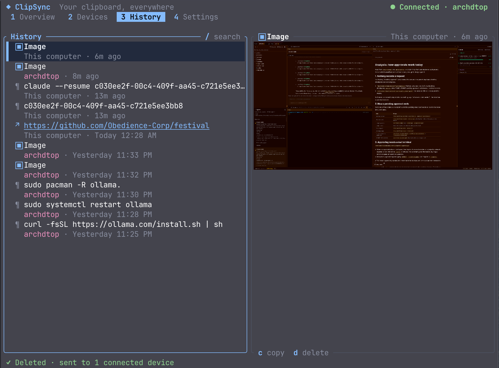
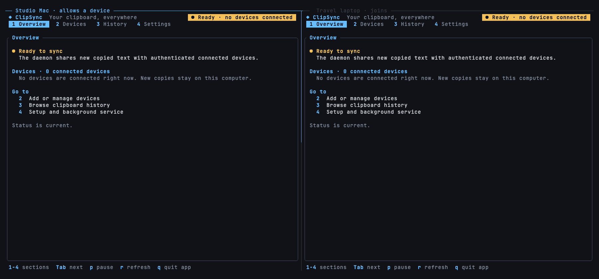
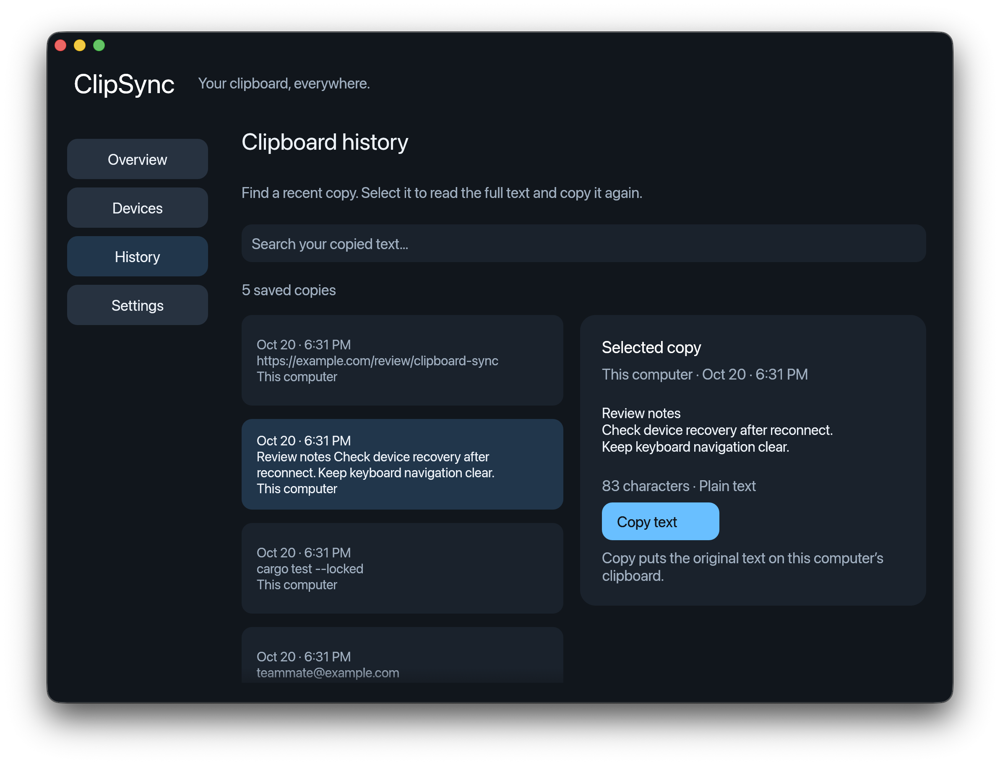
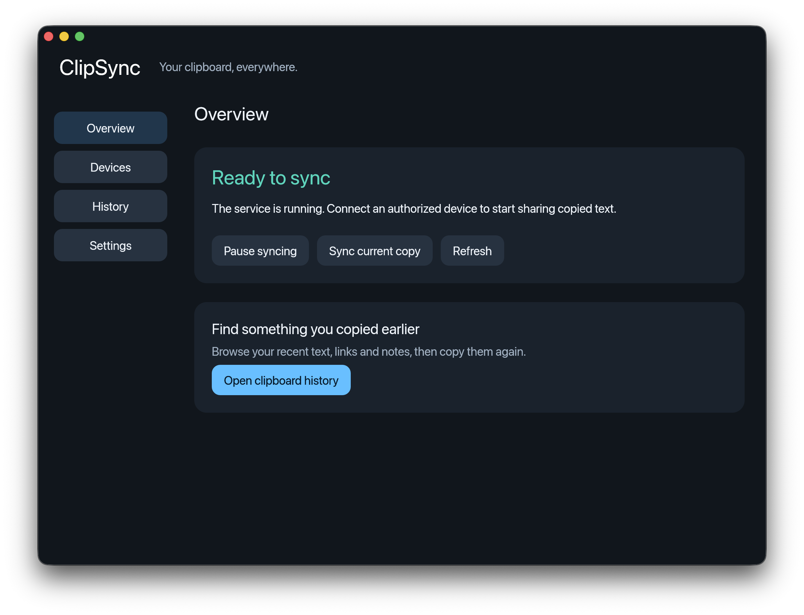

<p align="center">
  
</p>

<h1 align="center">ClipSync</h1>

<p align="center">
  <strong>Your clipboard, everywhere.</strong><br>
  Copy on one computer, paste on another. Text and images sync directly between<br>
  your Mac and Linux machines, from a terminal UI, a desktop app or the command line.
</p>

<p align="center">
  <a href="https://github.com/lancekrogers/clipsync/releases/latest"></a>
  <a href="https://aur.archlinux.org/packages/clipsync-bin"></a>
  <a href="#macos"></a>
  
  <a href="#license"></a>
  <a href="https://github.com/Obedience-Corp/festival"></a>
</p>

<p align="center">
  <a href="#install">Install</a> ·
  <a href="#pair-two-computers">Pair</a> ·
  <a href="#the-terminal-ui">Terminal UI</a> ·
  <a href="#the-desktop-app">Desktop app</a> ·
  <a href="#documentation">Docs</a>
</p>

<p align="center">
  
</p>

<p align="center"><sub><code>clipsync tui</code> on a Mac connected to an Arch Linux desktop: everything copied on either computer, in one history.</sub></p>

> [!NOTE]
> **Experimental.** Text sync works between macOS and Arch Linux. Image sync,
> broader desktop coverage, and sleep/wake and login/logout recovery are still
> being validated. Install the same release on every computer.

## Why ClipSync

<table>
<tr>
<td width="50%" valign="top">

**Terminal first**<br>
`clipsync tui` shows your devices, your synced history with image previews,
and settings, all from the keyboard.

</td>
<td width="50%" valign="top">

**Text and images**<br>
Copy text or a screenshot on one computer and paste it on the other.

</td>
</tr>
<tr>
<td valign="top">

**No cloud, no account**<br>
Computers connect directly over your local network with mutually
authenticated TLS 1.3.

</td>
<td valign="top">

**Pair with a code**<br>
Show a six-digit code on one computer and type it on the other. No Tailscale
or SSH needed, and finding a device never trusts it.

</td>
</tr>
<tr>
<td valign="top">

**One shared history**<br>
Search it, copy an entry again, delete one or clear it all. Deletes apply on
connected devices too.

</td>
<td valign="top">

**Desktop app and CLI**<br>
A desktop app and scriptable commands drive the same background service.

</td>
</tr>
</table>

## Install

Each [release](https://github.com/lancekrogers/clipsync/releases) has a macOS
disk image for Apple Silicon and Linux archives for x86_64 and aarch64.

### macOS

```sh
brew install --cask lancekrogers/tap/clipsync
```

This installs ClipSync.app, puts `clipsync` on your PATH and clears the
download quarantine flag, so the app opens without a Gatekeeper prompt.

<details>
<summary>Without Homebrew</summary>

<br>

Open the disk image from the [latest release](https://github.com/lancekrogers/clipsync/releases/latest)
and drag ClipSync to Applications. Release builds are not notarized by Apple,
so macOS blocks the first launch: click **Done**, open **System Settings →
Privacy & Security** and click **Open Anyway**. You only do this once. Or, before
the first launch, run:

```sh
xattr -dr com.apple.quarantine /Applications/ClipSync.app
```

The command-line tool is inside the app at
`/Applications/ClipSync.app/Contents/MacOS/clipsync`.

</details>

### Arch Linux

Install [`clipsync-bin`](https://aur.archlinux.org/packages/clipsync-bin) from
the AUR with `yay` or any other AUR helper:

```sh
yay -S clipsync-bin
```

It installs the release binaries to `/usr/bin` and adds ClipSync to your app
menu. Without an AUR helper:

```sh
git clone https://aur.archlinux.org/clipsync-bin.git
cd clipsync-bin
makepkg -si
```

### Other Linux

Download the archive for your architecture from the
[latest release](https://github.com/lancekrogers/clipsync/releases/latest), then:

```sh
tar -xzf clipsync-<version>-linux-x86_64.tar.gz
cd clipsync-<version>-linux-x86_64
./install-user.sh
```

It installs `clipsync` and `clipsync-desktop` to `~/.local/bin` and adds
ClipSync to your app menu, without root. The archives need glibc 2.35 or newer
and OpenSSL 3 (`libssl3` on Debian and Ubuntu, `openssl-3` on Arch Linux), so
they run on Ubuntu 22.04, Debian 12 and current Arch Linux.

<details>
<summary>Check a download</summary>

<br>

In the folder that holds the download and `SHA256SUMS`:

```sh
shasum -a 256 -c SHA256SUMS --ignore-missing   # macOS
sha256sum -c SHA256SUMS --ignore-missing       # Linux
```

</details>

### From source

With Rust 1.95 or newer, this installs `clipsync` with the terminal UI to
`~/.cargo/bin`:

```sh
cargo install --path . --locked --features tui   # or: just install
```

To build the desktop app too, run `just companion-package` and follow
[install from a local package](docs/COMPANION.md#install-from-a-local-package).

## Pair two computers

Run `clipsync tui` on both computers and finish setup. Then:

1. **On the first computer**, press `2` for Devices, then `e`. A six-digit code
   appears.
2. **On the second computer**, press `2`, then `f`, pick the first computer and
   press `Enter`. Not listed? Press `m` and enter the address shown under the
   code.
3. **Type the code.** Both computers now list each other under
   **Authorized devices**, and anything you copy on one shows up on the other.

<p align="center">
  
</p>

<p align="center"><sub>Pairing two isolated fixtures. Re-record with <code>just demo-tui-pairing</code> (macOS).</sub></p>

Each code works once, and neither computer saves anything until the code is
verified. Pairing uses TCP port 8485 and sync uses 8484. If a computer's
firewall blocks them, as firewalld's default zone does on EndeavourOS, show the
code on the other computer and type it on this one, or open both ports. See
[when pairing fails](docs/COMPANION.md#pair-two-computers) for every error
message and its fix.

## The terminal UI

`clipsync tui` has four sections: **Overview**, **Devices**, **History** and
**Settings**. Switch with `1`–`4`.

| Key | In History |
|---|---|
| `↑` `↓` | Select a copy |
| `/` | Search |
| `c` | Copy it again |
| `d` / `D` | Delete one, or clear all. Both ask first and apply on connected devices, like `clipsync history delete` and `clear` |
| `p` | Pause or resume syncing |
| `q` | Quit the TUI; syncing keeps running |

Selecting an image shows a preview: sharp in terminals with Kitty or Sixel
graphics, and drawn with colored characters elsewhere. Set
`CLIPSYNC_TUI_GRAPHICS=off` to force the character preview, or `NO_COLOR` for
grayscale.

<p align="center">
  
</p>

<p align="center"><sub>Overview, Devices and History against an isolated fixture. Re-record with <code>just demo-tui</code> (macOS).</sub></p>

## The desktop app

The desktop app has the same four sections and pairs the same way. It can
also check your setup, start or stop the background service, and pause syncing.
On macOS, open **ClipSync** from Applications; on Linux, launch it from the app
menu.

<table>
<tr>
<td width="50%"></td>
<td width="50%"></td>
</tr>
<tr>
<td align="center"><sub>History</sub></td>
<td align="center"><sub>Overview</sub></td>
</tr>
</table>

<p align="center"><sub>Sample data in an isolated test setup.</sub></p>

## How it works

- A background service on each computer owns the clipboard. The terminal UI,
  desktop app and `clipsync` commands all talk to it, so closing them leaves
  syncing running.
- Computers find each other with mDNS and connect directly over TCP with
  mutually authenticated TLS 1.3 and Ed25519 device identities. No cloud
  service is involved.
- History contents are encrypted with AES-256-GCM; database metadata is not.

Read the [security model](docs/SECURITY.md), including
[what a stranger on the same network can and cannot do](docs/SECURITY.md#pairing-a-new-device),
and [what syncs and its limits](docs/LIMITS.md).

## Documentation

| Guide | What's in it |
|---|---|
| [Desktop app and TUI](docs/COMPANION.md) | Local packages, pairing errors, upgrading, uninstalling |
| [Command line and manual setup](docs/CLI.md) | `clipsync` commands, SSH-key setup, background services, troubleshooting, history recovery |
| [What syncs](docs/LIMITS.md) | Supported clipboards, size limits, history retention |
| [Security model](docs/SECURITY.md) | Pairing, transport, encryption and their limits |
| [Verification](docs/COMPANION_ACCEPTANCE.md) | Isolated checks and release gates |
| [Release checklist](docs/RELEASE_CHECKLIST.md) | Cutting a release |

## Development

```sh
cargo +1.95.0 build --locked --workspace --features tui
./target/debug/clipsync tui
./target/debug/clipsync-desktop

just check          # formatting and Clippy
just test           # unit/integration tests; private named pasteboards on macOS
just test-desktop   # Docker: Linux suite plus two real X11 and two headless Wayland daemons
```

The desktop harness refuses to run outside its disposable container. It
generates temporary identities and history stores and does not mount personal
configuration or clipboard sockets. See [repair validation](docs/REPAIR_VALIDATION.md)
for evidence and limits.

## License

Dual licensed under [MIT](LICENSE-MIT) or [Apache-2.0](LICENSE-APACHE).
